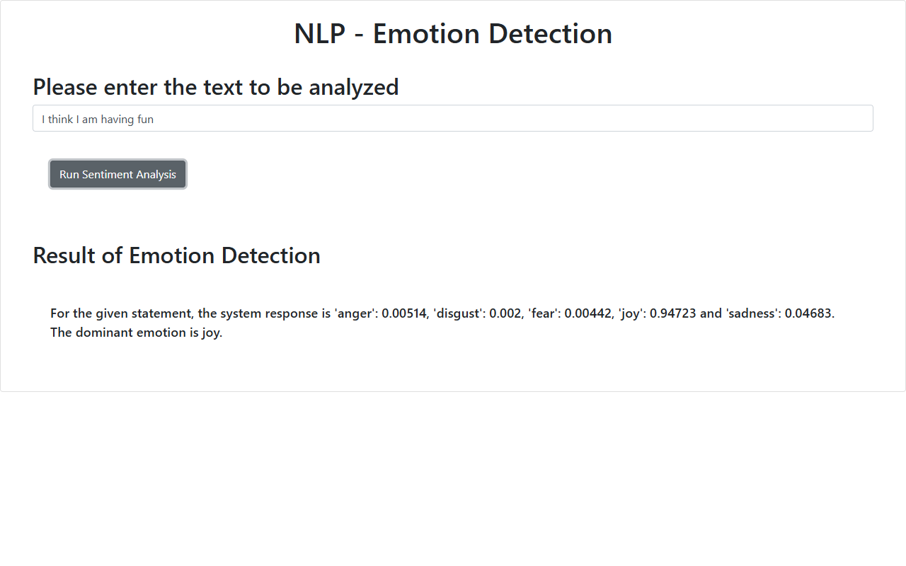
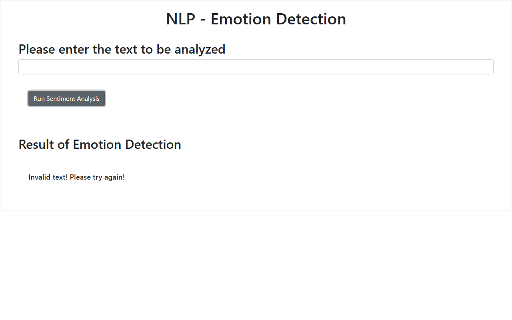

# Emotion Detection Web Application

Final Project for IBM / Coursera: **Developing AI Applications with Python and Flask**

## Project Overview

This project implements an AI-powered Emotion Detection web application using the IBM Watson NLP (Natural Language Processing) Emotion Predict service, packaged as a reusable Python module and deployed as an interactive web service using Flask.

The application detects five core emotions from text:
- **anger**
- **disgust**
- **fear**
- **joy**
- **sadness**

It returns individual confidence scores for each emotion and identifies the **dominant emotion**.

---

## Project Structure

```
emotion-detector/
├── EmotionDetection/
│   ├── __init__.py               # Package initialization (exports emotion_detector)
│   ├── emotion_detection.py      # Watson NLP API integration & emotion extraction
│   └── test_emotion_detection.py # Unit tests for package
├── static/
│   └── mywebscript.js            # Client-side AJAX script
├── templates/
│   └── index.html                # Web user interface (Bootstrap 4)
├── test_emotion_detection.py     # Root test suite for Coursera grading
├── server.py                     # Flask application server (port 5000)
├── requirements.txt              # Project dependencies
├── 6b_deployment_test.png        # Screenshot: Deployment test with valid text
├── 7c_error_handling_interface.png # Screenshot: Error handling on blank input
├── capture_screenshots.py        # Automated test verification and capture script
└── README.md                     # Documentation
```

---

## Features

1. **IBM Watson NLP Integration**: Queries Watson NLP Emotion Predict service (`emotion_aggregated-workflow_lang_en_stock`).
2. **Modular Python Package**: Packaged in `EmotionDetection` for simple imports (`from EmotionDetection import emotion_detector`).
3. **Comprehensive Unit Testing**: Validates dominant emotion outputs across 5 core emotional statements.
4. **Flask Web Server**: Deployed on `localhost:5000` with `/` and `/emotionDetector` routes.
5. **Robust Error Handling**: Handles HTTP 400 responses, empty strings, and whitespace input returning `None` values, displayed as `"Invalid text! Please try again!"` on the web interface.
6. **Code Quality**: Verified with **Pylint** achieving a perfect **10.00 / 10.00** score.

---

## Installation & Setup

### 1. Clone the repository
```bash
git clone https://github.com/aaryanbangale2306/emotion-detector.git
cd emotion-detector
```

### 2. Create and activate virtual environment
```bash
python -m venv .venv
# On Windows:
.venv\Scripts\activate
# On Linux / macOS:
source .venv/bin/activate
```

### 3. Install dependencies
```bash
pip install -r requirements.txt
```

---

## Running the Application

Start the Flask development server:
```bash
python server.py
```

Access the web interface by opening your browser to:
```
http://localhost:5000
```

---

## API Endpoints

### 1. Web Page (`GET /`)
Renders `templates/index.html` with an input field and submission button.

### 2. Emotion Detector (`GET /emotionDetector`)
Analyzes text provided via query parameter `textToAnalyze`.

#### Request:
```
GET /emotionDetector?textToAnalyze=I%20think%20I%20am%20having%20fun
```

#### Response (Success):
```
For the given statement, the system response is 'anger': 0.00514, 'disgust': 0.002, 'fear': 0.00442, 'joy': 0.94723 and 'sadness': 0.04683. The dominant emotion is joy.
```

#### Response (Blank / Invalid input):
```
Invalid text! Please try again!
```

---

## Running Unit Tests

Run the test suite using Python's built-in `unittest` module:
```bash
python -m unittest -v test_emotion_detection.py
```

### Test Cases Verified:
| Statement | Expected Dominant Emotion | Status |
|---|---|---|
| `"I am glad this happened"` | `joy` | ✅ PASS |
| `"I am really mad about this"` | `anger` | ✅ PASS |
| `"I feel disgusted just hearing about this"` | `disgust` | ✅ PASS |
| `"I am so sad about this"` | `sadness` | ✅ PASS |
| `"I am really afraid that this will happen"` | `fear` | ✅ PASS |
| `""` (blank input) | `None` | ✅ PASS |

---

## Static Code Analysis (Pylint)

Run Pylint to check code quality and style conformity:
```bash
pylint server.py
```
**Score Achieved**: **10.00 / 10.00**

---

## Verification Screenshots

### 1. Deployment Test (`6b_deployment_test.png`)


### 2. Error Handling Interface (`7c_error_handling_interface.png`)


---

## Author

**Aaryan Bangale**  
GitHub: [aaryanbangale2306](https://github.com/aaryanbangale2306)
